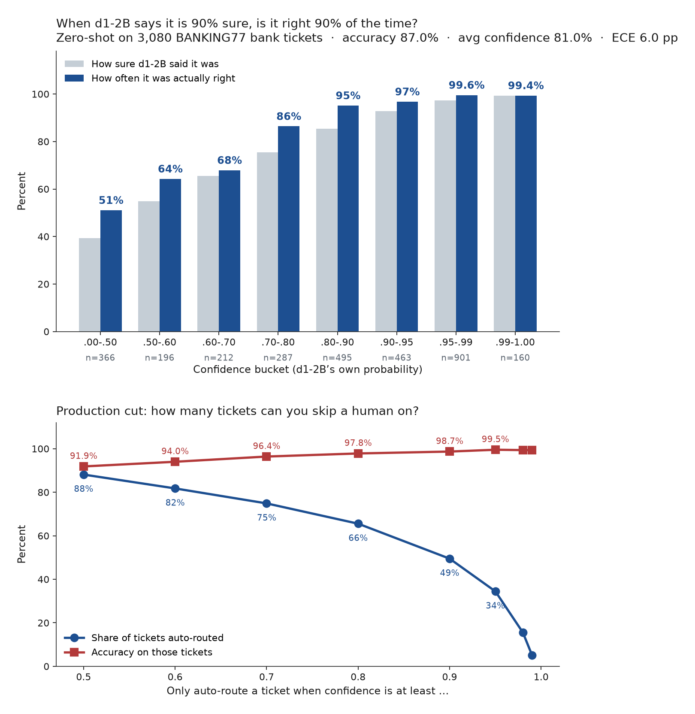

# Does d1-2B mean it when it says it is 90% sure?

**Not exactly — it is more careful than the number.** On 3,080 real bank tickets, answers at ≥90% confidence were right **98.7%** of the time (1,504 / 1,524). Zero-shot accuracy was **87.0%**; ECE was **6.0 percentage points** because the model is systematically underconfident, not because it is reckless.

[Liquid AI d1-2B](https://huggingface.co/LiquidAI/d1-2B) (LFM3 family, released 27 October 2026) is a 1.92B “decision model”: one forward pass, a label plus a calibrated probability, no generated tokens. This repo is a public, CPU-only check of that probability on [BANKING77](https://huggingface.co/datasets/PolyAI/banking77).

## Method

- **Task.** Zero-shot 77-way intent classification. Each ticket is one `choice` question: *“Which banking request is the customer making?”* Criteria names are the BANKING77 labels with underscores turned into spaces. No examples, no fine-tuning, no prompt search.
- **Model.** `LiquidAI/d1-2B`, revision [`cfe5760ff`](https://huggingface.co/LiquidAI/d1-2B/commit/cfe5760ff5d5998f91d9ac56bd4b2dbd96996d41), `trust_remote_code=True` as the card requires. A choice answer is `{choice, confidence, probabilities}`. The shipped temperature (`calibration.json` default **1.3374**) is applied inside the model; headline numbers leave it alone.
- **Data.** The 3,080-row BANKING77 test split (Casanueva et al., 2020): 40 queries × 77 intents. File: [`data/banking77_test.csv`](data/banking77_test.csv).
- **Metrics.** Accuracy; 10-bin equal-width expected calibration error; a high-end reliability diagram (77-way confidence piles up above 0.5); accuracy and coverage at confidence ≥ 0.90; auto-route curves.
- **Held-out threshold.** The card says “Calibrate any decision threshold on data from your own use.” Odd rows (20 per intent) pick the lowest cutoff that hits 95% / 98% / 99% precision; even rows report coverage and precision at that cutoff. A second variant refits the probability with isotonic regression on the odd half.
- **Latency.** Sequential CPU inference (`batch=1`) in native **bfloat16** (the checkpoint dtype) on 4 vCPU, no GPU. The card’s CPU snippet uses float32; a 4-ticket probe here was ~2.0 s/ticket in float32 vs ~0.9 s in bf16, so the reported run is bf16. Hardware: [`results/hardware.json`](results/hardware.json).

## Reproduce

```bash
python3 -m venv .venv && source .venv/bin/activate
pip install -r requirements.txt
./run.sh                 # unit tests, full 3,080, metrics, chart
./run.sh --limit 20      # smoke test
```

`run_eval.py` is resume-safe (appends to `results/predictions.jsonl`). The committed run took **22.8 minutes** wall time (1,367 s) on this 4-vCPU box. No API key.

Pinned stack: `transformers==5.19.0` (the version the model card asks for), `torch==2.15.0` CPU. See [`requirements.txt`](requirements.txt).

## Results

Every figure below is computed from [`results/predictions.jsonl`](results/predictions.jsonl) (one JSON object per ticket, including the full 77-way distribution). Compact table: [`results/predictions.csv`](results/predictions.csv). Metrics: [`results/metrics.json`](results/metrics.json).

| | |
|---|---|
| Tickets | 3,080 |
| Correct | 2,680 (**87.0%**) |
| Mean confidence | **81.0%** |
| ECE (10 equal-width bins) | **6.0 pp** |
| Confidence ≥ 0.90 | **1,524** tickets (**49.5%** of the set), **1,504 / 1,524 = 98.7%** right (Wilson 95% CI 98.0–99.1%) |
| Confidence ≥ 0.95 | 1,061 tickets (34.4%), 99.5% right; **5** mistakes, all neighbouring intents |
| CPU latency | median **0.43 s/ticket**, mean 0.44, p90 0.48 (4 vCPU, bf16, batch=1) |

The 87% accuracy is against a 1.3% random baseline (77 labels). Mean confidence 81% vs accuracy 87% is the same story as the chart: the model is **underconfident**.



In the 0.90–0.95 bucket specifically it *said* 92.8% and was right 96.8% (n=463). The 0.99–1.00 bucket is essentially calibrated (said 99.3%, right 99.4%, n=160). The 6.0 pp ECE is that gap, weighted — not a pile of overconfident errors.

### Auto-route (full test set)

These cutoffs are chosen and scored on the same 3,080 tickets, so they are slightly optimistic. Use the split in the next section for a production number.

| Min confidence | Tickets covered | Accuracy on those tickets | Wilson 95% lower bound |
|---|---|---|---|
| ≥ 0.50 | 88.1% (2,714) | 91.9% | 90.8% |
| ≥ 0.70 | 74.9% (2,306) | 96.4% | 95.6% |
| ≥ 0.80 | 65.6% (2,019) | 97.8% | 97.1% |
| ≥ 0.90 | 49.5% (1,524) | 98.7% | 98.0% |
| ≥ 0.95 | 34.4% (1,061) | 99.5% | 98.9% |

Lowest full-set cutoff whose *point-estimate* precision is at least the target:

| Target precision | Cutoff | Coverage | Accuracy |
|---|---|---|---|
| 95% | ≥ 0.654 | 78.6% | 95.0% |
| 98% | ≥ 0.834 | 60.9% | 98.0% |
| 99% | ≥ 0.924 | 43.4% | 99.0% |

### Threshold fitted on half, scored on the other half

Odd rows (1,540 tickets, 20 per intent) pick the cutoff; even rows are untouched until scoring. This is the protocol the model card is pointing at.

| Target precision | Cutoff chosen on odd rows | Even-row coverage | Even-row precision | Wilson 95% CI on even rows |
|---|---|---|---|---|
| 95% | ≥ **0.675** | **75.8%** (1,167 / 1,540) | **96.4%** | 95.2–97.3% |
| 98% | ≥ **0.891** | **50.3%** (774 / 1,540) | **99.4%** | 98.5–99.7% |
| 99% | ≥ **0.933** | **40.0%** (616 / 1,540) | **99.5%** | 98.6–99.8% |

A bank that can live with ~4% misroutes can auto-route about three quarters of tickets at confidence ≥ 0.675. One that wants ~98%+ precision should set the bar around 0.89 and still skip a human on half the queue. Fitting the cutoff on 1,540 labelled tickets was enough; the even half came in *above* the target, not below.

Isotonic regression on the odd half drops even-row ECE from 6.7 pp to **1.0 pp** and is in [`results/recalibration.json`](results/recalibration.json). Undoing the shipped temperature (recovering `softmax(s)` as `p_i ** 1.3374`, renormalised) also helps: even-row ECE 2.3 pp, mean confidence 88.5% vs accuracy 87.0%. On this 77-way task the global temperature over-flattens the distribution. Headline numbers do **not** use either fix.

The five ≥0.95 mistakes are near-duplicate intents (`card_not_working` → `pin_blocked`, `declined_transfer` → `declined_card_payment`, `virtual_card_not_working` → `card_not_working`, `get_disposable_virtual_card` → `disposable_card_limits`, `exchange_charge` → `exchange_rate`).

## Limitations

- **One domain, one size.** BANKING77 labels are fine-grained and overlap. A coarser routing taxonomy (billing / cards / transfers) would look different.
- **Zero-shot criterion text is the label.** A bank that wrote real queue descriptions would likely do better. That is a different experiment.
- **Threshold search overfits if you do it on the tickets you report.** The full-set curve is what a dashboard would plot; the split table is the number to quote.
- **CPU bf16, not the card’s CPU float32.** Confidences were within about a point on a 4-ticket probe; they are not bit-identical. No GPU was available.
- **d1-2B is not a chatbot.** It does not draft a reply. The question is only whether the probability on an intent is usable for routing.
- **No BERT / LLM-as-judge baseline.** The claim under test is d1’s own: that the number it returns is already calibrated.

## Files

| Path | What |
|---|---|
| `run_eval.py` | Load d1-2B, score every ticket, write JSONL (resume-safe) |
| `score.py` | Accuracy, ECE, bins, auto-route → `results/metrics.json` + `predictions.csv` |
| `recalibrate.py` | Odd/even split, threshold transfer, isotonic, undo-temperature |
| `plot.py` | `results/reliability.png` |
| `metrics.py` / `test_metrics.py` | Shared maths and unit tests (no model needed) |
| `results/predictions.jsonl` | Raw per-ticket output: gold, pred, confidence, full 77-way probs, seconds |
| `./run.sh` | One command: tests + eval + score + chart |

## Links

- Model: [LiquidAI/d1-2B](https://huggingface.co/LiquidAI/d1-2B)
- LFM3 blog: [huggingface.co/blog/LiquidAI/lfm3](https://huggingface.co/blog/LiquidAI/lfm3)
- Dataset: [PolyAI/banking77](https://huggingface.co/datasets/PolyAI/banking77) — Iñigo Casanueva, Tadas Temčinas, Daniela Gerz, Matthew Henderson, Ivan Vulić, *Efficient Intent Detection with Dual Sentence Encoders*, NLP for ConvAI, 2020.

## License

Experiment code in this repo is CC0. BANKING77 is cited as above. d1-2B is under the [LFM Open License v1.0](https://huggingface.co/LiquidAI/d1-2B).
